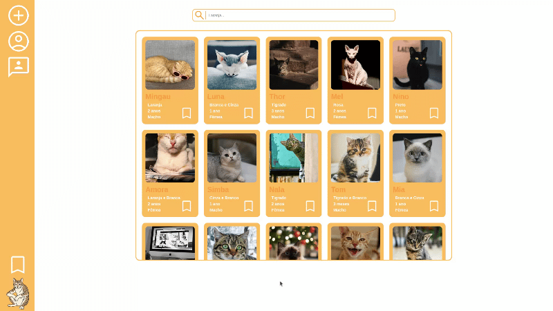
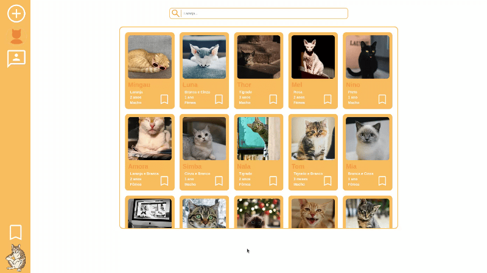

# Ronrom

## O que é o Ronrom?

O projeto Ronrom é uma aplicação web cujo objetivo é conscientizar e simplificar exclusivamente a adoção de gatos. O projeto Ronrom se utiliza das linguagens `HTML, CSS, Javascript e Python`, essas linguagens são responsáveis por constituir o projeto Ronrom e ajudar a manter o conceito do projeto, cumprindo exatamente com a simplicidade representada pelo Front-end (HTML, CSS e Javascript) que facilita o acesso a ferramenta e por outro lado o Back-end (Python) que facilita e serve a movimentação de dados com o Flask, além de constituir o proprio banco de dados com a criação e gestão através do sqlite3. Cada componente da construção reflete no projeto trazendo a simplificação e o alcance a conscientização, ambos são o foco do projeto.

## Estrutura de Arquivos

A estrutura de arquivos se refere ao modo de organização do projeto. A estrutura de arquivos conta com a separação de acordo com aspectos de sistemas como a parte principal que é o front-end (HTML, CSS e Javascript) cada um tem sua pasta dentro da pasta `web`, o `Backend` por sua vez junta todos os arquivos relacionados ao Flask e ao sqlite3 e o `database` é responsável pelo arquivo .db produzido pelo sqlite3. essa é a estrutura que compõe a pasta `web` que é a pasta do projeto, além disso á também os arquivos padrão de todo repositório.

- assets/
- web/
    - assets/
    - backend/
    - css/
    - database/
    - html/
    - js/
- .gitignore
- LICENSE
- README.md
- pre-projeto.md

## Funcionalidades

As funcinalidades atuais são representadas em três grupos. As funcionalidades refletem o projeto comuma visão geral, portanto é muito importante das enfâse nessa questão, além de organizalas em classes dependendo do projeto, esse projeto tem três classes para as funções `Gestão de conta`, `Segurança da conta` e `Feed de adoção`:

- Gestão da Conta:

    - Cadastro de usuários: O Ronrom possui atualmente o cadastro de usuários através de email e senha;
    - Edição de usuários: A aplicação permite a edição de usuários, possibilitando mudança de foto, nome de usuário, E-mail e senha;
    - Envio de E-mail: Além da gestão de usuário a aplicação permite o envio de E-mail através de ferramentas como "esqueci a senha" ou confirmação para atividades de edição;

        

- Segurança da Conta:

    - Verificação de E-mail: Através do envio de E-mail a plataforma permite que a conta do usuário possa ser verificada por segurança, através de um  código de confirmação com prazo e reenvio;
    - Recuperação de senha: A plataforma disponibiliza a recuperação de senha através do E-mail;
    - Validação de senha: A plataforma verifica dentro do banco de dados se sua senha realmente está correta;

        

- Feed de Adoção:

    - Gestão de feed com imagens: A aplicação permite a visibilidade de gatos para adoção através de imagens dentro do feed principal;
    - Visualização de detalhes no feed: O feed além de disponibilizar as imagens também permite inicialmente informações cruciais para quem adota e detalhadamente informações mais concretas;
    - Navegação vertical com scroll: O sistema de navegação permite a facilidade de visualizar todos os gatos através da ferramenta de scroll do mouse;
    - Ferramenta de pesquisa no feed: O feed permite pesquisar adereços relacionados a escolha de quema adota.

        

## Como executar o projeto

1. Clone o repositório https://github.com/uellpng-tech/ronrom.git;
2. Extraia o arquivo `.zip` gerado após a clonagem;
3. Acesse a pasta do projeto dentro do terminal;
4. Crie a máquina virtual dentro da pasta do projeto `python -m venv .venv`;
5. Ative a máquina virtual:
    - Windows: `.venv\Scripts\activate`;
    - Linux / macOS: `source .venv/bin/activate`.
6. Acesse a pasta `web` pelo terminal e logo em seguida a pasta `backend`;
7. Instale as bibliotecas através do `requirements.txt` `pip install -r requirements.txt`.

OBS: Caso o banco venha sem informações ou não esteja funcionando basta executar os scripts da pasta backend `criar_banco.py` e `adicionar_exemplos.py`.

## Detalhes Adicionais

Alguns outros aspectos não menos importantes fizeram parte da criação do projeto como um todo. Os detalhes são tudo aquilo que compõe a pré-criação do projeto, antes de criar eu produzi slides e pré-projeto em conjunto com uma apresentação da beta do Ronrom, portanto gostaria de deixar uma menção honrosa aos pré-projetos que tornaram a criação possível.

- [Pré-Projeto](pre-projeto.md)
- [Slides](assets/slides-ronrom.pdf)